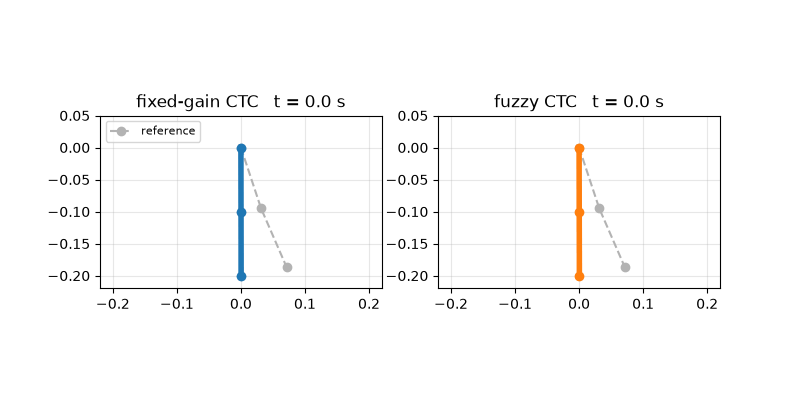
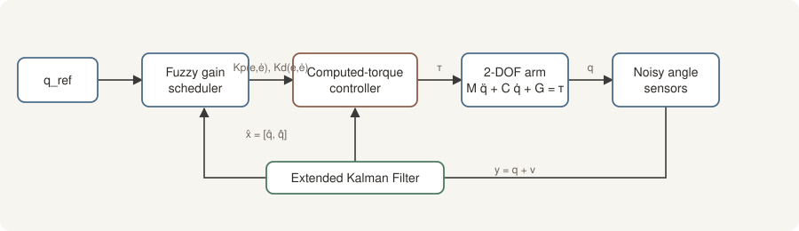
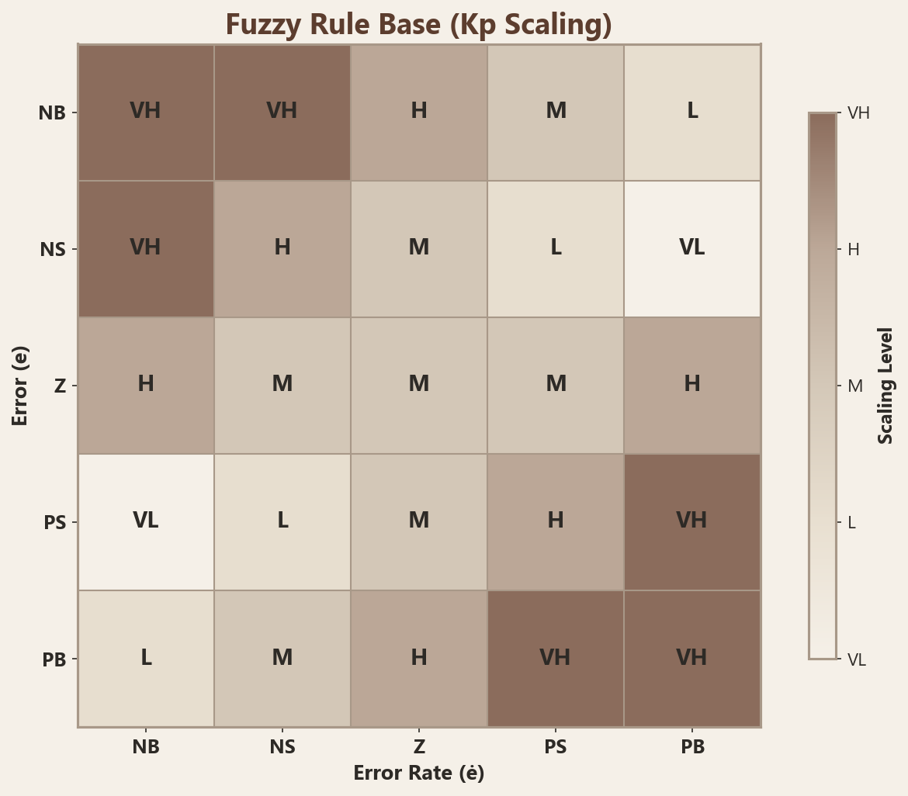
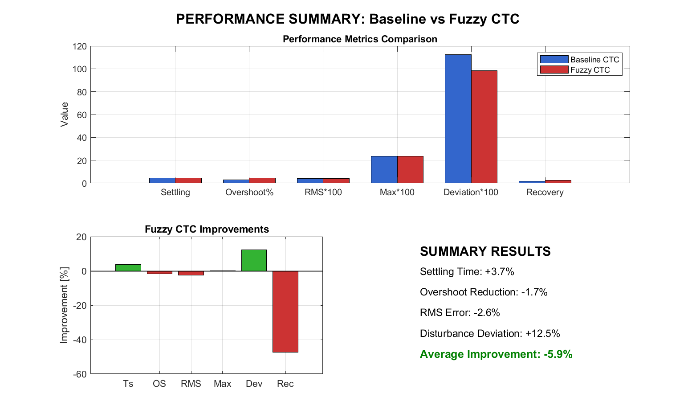
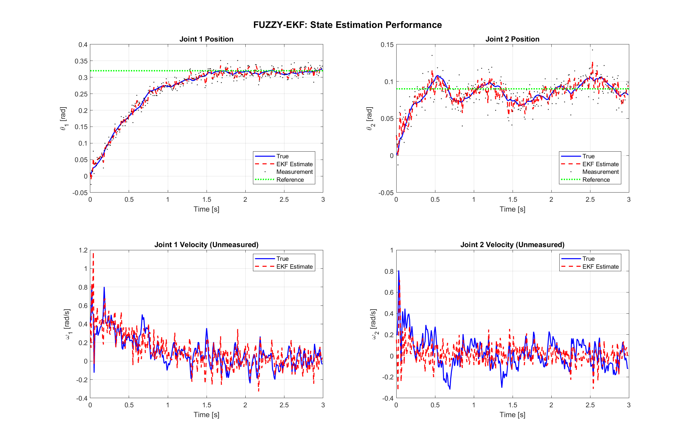
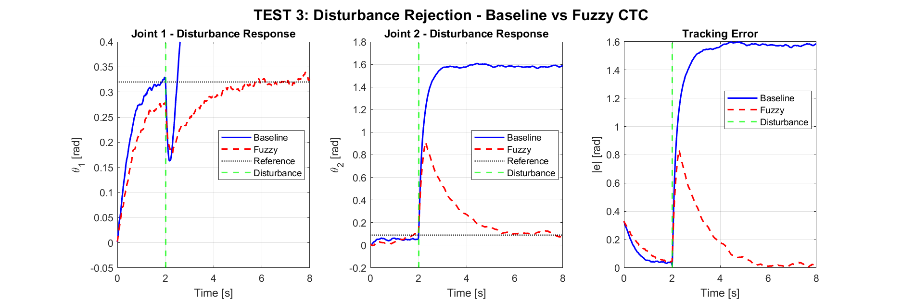
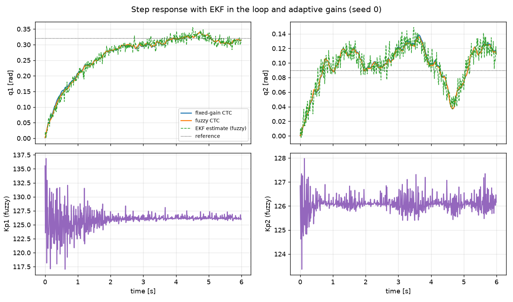

# EKF + Fuzzy Computed-Torque Control for a 2-DOF Manipulator

**Graduation thesis, Control and Automation Engineering, Yıldız Technical University (2026).**
A 2-DOF robot arm tracks a joint-space reference using only noisy angle measurements: an Extended Kalman Filter estimates the full state, and a fuzzy gain scheduler adapts the computed-torque controller's gains online.


<p align="center"></p>
<p align="center"><sub>Rendered from the Python port: step to the reference, then a 1 N·m torque pulse at t = 6 s (<code>python/make_animation.py</code>).</sub></p>

## Architecture

<p align="center"></p>

| Block | What it does |
|---|---|
| **Dynamics** | Lagrangian model `M(q) q̈ + C(q, q̇) q̇ + G(q) = τ` for two revolute links (1 kg, 0.1 m each). |
| **Computed-torque control** | Cancels the nonlinear dynamics: `τ = M(q̂)(−Kp e − Kd ė) + C + G`, saturated at ±15 N·m. |
| **Fuzzy gain scheduler** | 5 Gaussian membership functions on normalised `e` and `ė`, a 5×5 rule base for each gain, weighted-average defuzzification. Scales `Kp`, `Kd` within ±50 % of nominal (100, 90). |
| **Extended Kalman Filter** | RK4 prediction, numerical Jacobian, Joseph-form update. Only joint angles are measured, so velocities come from the filter. NIS is logged to check filter consistency. |

<p align="center"></p>

## Results

### Thesis results (MATLAB)

These come from the thesis simulation scripts in [`matlab/`](matlab/), copied from their console output.

| Test | Metric | Fixed-gain CTC | Fuzzy CTC | Change |
|---|---|---|---|---|
| T1 step | Settling time | 4.62 s | 4.45 s | 3.7 % faster |
| T1 step | RMS error | 0.0199 rad | 0.0182 rad | 8.9 % lower |
| T1 step | Overshoot (joint 1) | 2.82 % | 4.57 % | worse |
| T2 trajectory | RMS error | 0.0414 rad | 0.0425 rad | 2.6 % higher |
| T3 disturbance | Max deviation | 1.124 rad | 0.984 rad | 12.5 % lower |
| T3 disturbance | Recovery time | 1.67 s | 2.46 s | slower |

EKF tuning (Q/R sensitivity sweep and NIS-based adaptation) moved the mean NIS from 1.35 to 2.0, the theoretical value for two measurements. Samples inside the 95 % bound went from 90.3 % to 95.5 %, and angle estimation error dropped from 0.135 to 0.089 rad.

**Takeaway:** fuzzy scheduling helps most on large disturbances (smaller peak deviation) and on step tracking error. It costs some overshoot and recovery speed, a trade-off governed by the Kd rules.

<p align="center"></p>
<p align="center">
  
  
</p>

### Python port (reproducible without MATLAB)

[`python/nac`](python/nac) is a compact NumPy port of the same dynamics, scheduler and EKF. One difference: the port computes the model terms from the EKF estimate, not the true state, which is stricter than the MATLAB loop. It runs in seconds and writes [`reports/results.md`](reports/results.md). Each value below is the mean over 10 noise seeds:

| Metric (step to q = [0.32, 0.09] rad) | Fixed-gain CTC | Fuzzy CTC |
|---|---|---|
| Settling time, joint 1 (±0.03 rad) | 2.42 s | 2.34 s |
| Overshoot, joint 1 | 5.22 % | 5.19 % |
| Steady-state RMS error | 0.0171 rad | 0.0161 rad |
| EKF angle estimation RMS error | 0.0096 rad | 0.0096 rad |
| Peak torque | 2.92 N·m | 3.41 N·m |

With a 1 N·m, 100 ms torque pulse on joint 1, the peak deviation was 0.537 rad (fixed) vs 0.525 rad (fuzzy). Both recovered in 2.98 s. The port shows the same direction as the thesis, with smaller margins. Exact numbers differ because the noise realisations and the state used inside the controller differ.

<p align="center"></p>

## Quickstart

```bash
# Python port
uv venv --python 3.12 .venv && uv pip install -p .venv -r requirements.txt
.venv/bin/pytest -q                               # 7 tests
cd python && ../.venv/bin/python run_experiments.py   # figures + reports/results.md
../.venv/bin/python make_animation.py                  # assets/simulation.gif
```

```matlab
% Original MATLAB code
addpath(genpath('matlab'));
fuzzy_ctc_simulation      % EKF + fuzzy CTC step response
step_disturbance_test     % disturbance rejection
standard_ctc_simulation   % fixed-gain baseline
```

## Project structure

```
matlab/
  ctc/         fixed-gain computed-torque baseline
  fuzzy_ctc/   fuzzy gain scheduler (manual Mamdani + optimised), CTC v2, disturbance tests
  ekf/         EKF predict/update, Jacobians, dynamics, EKF + fuzzy simulation
python/
  nac/         dynamics.py, fuzzy.py, ekf.py, simulate.py
  run_experiments.py, make_animation.py
tests/         pytest suite for the port
assets/        thesis MATLAB figures, diagram, simulation GIF
reports/       Python port results and figures
```

## What I'd do next

- Replace the hand-tuned rule base with gains learned offline (e.g. Bayesian optimisation over the rule consequents).
- Add an Unscented Kalman Filter and compare consistency against the EKF.
- Run the controller on hardware with encoder quantisation and actuator delay.
